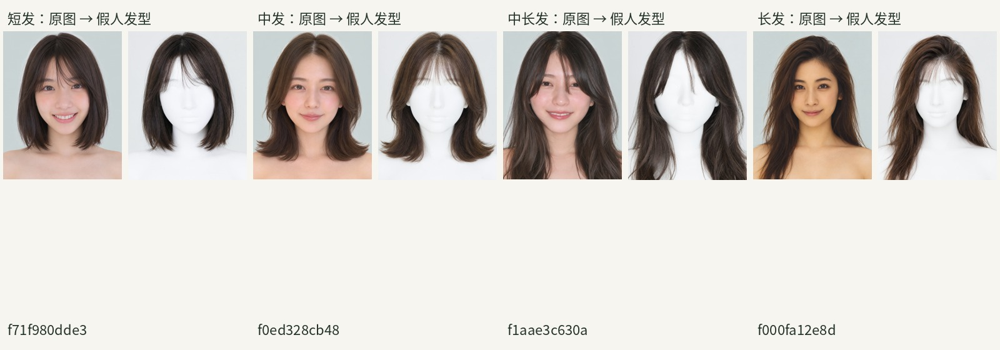
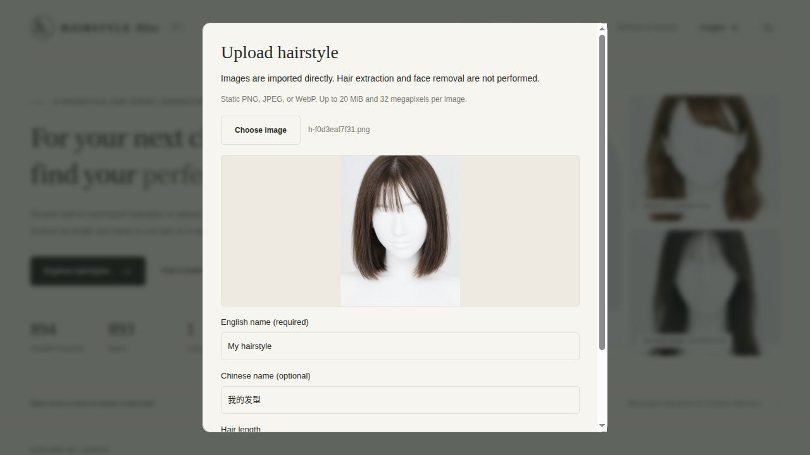
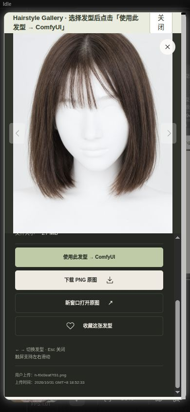
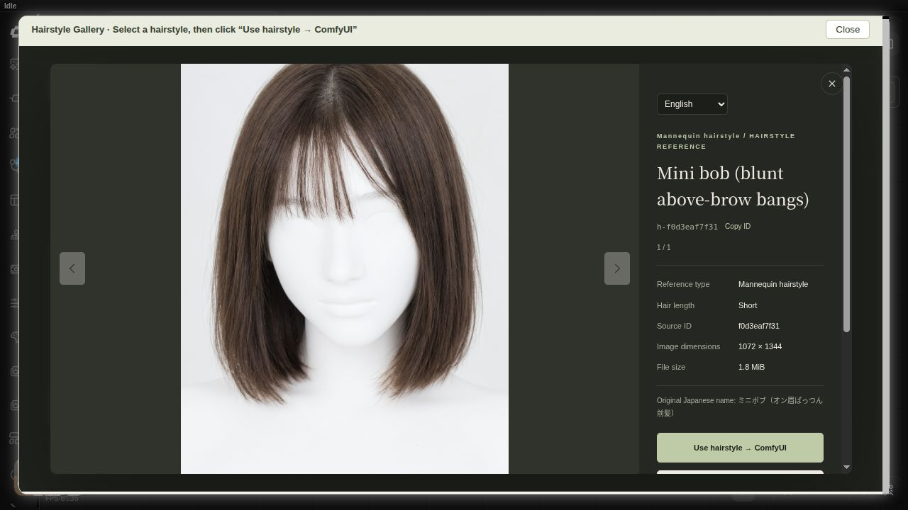

# comfyui-hairstyle-gallery

[简体中文](README.md) · **English**

An offline mannequin hairstyle gallery for ComfyUI. It follows Portrait Gallery's warm, responsive layout with filters, search, favorites, and large previews, so hairstyle references can be used separately from character identity.

The collection contains **893 generated hairstyles**, extracted from the face-reference section of `comfyui-portrait-gallery`: 433 short, 229 medium, 154 medium-long, and 77 long. The source styling-photo section was not used. There are 2,679 image assets (full-size PNG, preview WebP, and thumbnail WebP), totaling about 1.87 GiB. Integrity checks passed; see `library/data/audit-report.json`.

There are 54 distinct name labels: 744 images retain detailed source style names; 149 use the source hair-length category because no detailed name was supplied. Names describe source labels rather than a new visual classification.



## Installation and browsing

Clone this repository inside `ComfyUI/custom_nodes/`. It includes all 893 full-size PNGs, previews, thumbnails and names (about 1.87 GiB); no separate ZIP is needed. Install dependencies with ComfyUI's Python, restart ComfyUI, and refresh the browser.

```bash
git clone https://github.com/wangweihong/comfyui-hairstyle-gallery.git
python -m pip install -r comfyui-hairstyle-gallery/requirements.txt
```

 Add **image → Hairstyle Gallery → Hairstyle Gallery**, then click **Browse hairstyles**.

Filter by length and style, or search English, Chinese, and Japanese names, hairstyle IDs, and source portrait IDs. Open a large preview and click **Use hairstyle → ComfyUI** to update the current node. Selection updates the preview without running the workflow.

The default library is the node's `library/` directory. This machine stores its data at `/media/wwhvw/备份/comfyui/发型/`; the installed node and container-visible mirror share image files through hard links. The repository includes a ready-to-use `library/`. To use a different copy, set `COMFYUI_HAIRSTYLE_GALLERY_LIBRARY` to a complete library path visible inside the ComfyUI environment/container.

## Upload one custom hairstyle

1. Click **Upload hairstyle** in either the standalone gallery or the gallery opened from a node.
2. Choose a finished hairstyle reference image and inspect its preview. Enter a name in the current interface language; the other-language name is optional. Hair length defaults to **Unspecified**.
3. Click **Save to gallery**. On success, the gallery switches to Custom, clears filters, and opens the new image viewer.
4. Click **Use hairstyle → ComfyUI** to update the current node. Neither uploading nor selecting queues a workflow.

Static PNG, JPEG, and WebP are supported, one image at a time, up to 20 MiB and 32 megapixels. The server validates actual image content, normalizes the full image to PNG while preserving dimensions and transparency, and creates white-background previews and thumbnails. **Import does not extract hair or remove faces.** This first version does not include batch import, editing, deletion, or automatic extraction.

Custom assets default to **`ComfyUI/user/hairstyle_gallery/`**, separate from node code and bundled assets:

```text
user/hairstyle_gallery/
  data/custom.json   Names, original filename, length, dimensions, and upload time
  img/full/          Full-resolution PNG
  img/preview/       WebP within 800×1000
  img/thumb/         WebP within 400×500
```

Node upgrades do not overwrite this directory; back it up separately. Clients of this local ComfyUI service share the library; there is no browser- or account-level isolation. Set `COMFYUI_HAIRSTYLE_GALLERY_USER_LIBRARY` to override the storage location with a persistent, writable path visible inside the container/environment.

The gallery adds **All sources / Built-in / Custom** filters and separate counts. Custom assets work even when the built-in index is absent. Custom IDs use `u-` plus a UUID, and their `source_id` output is an empty string. User-entered names take priority; if the other language is omitted, the provided name is reused without automatic translation.

API: `POST /hairstyle_gallery/upload` with multipart fields `image`, `name`, optional `other_name`, `language` (zh/en), and `hair` (unknown/short/medium/medium-long/long). Success returns HTTP201 with `record` and the refreshed `catalog`. Failures return JSON error codes without committing incomplete assets. The existing catalog endpoint keeps its array response and adds `origin=builtin/user`; asset reads remain restricted to registered IDs.





## Chinese / English switching

- Use the **English / 中文** button next to the node's Browse button, or the language selector at the top of the gallery. The current node and its embedded gallery stay in sync.
- The optional `language` input accepts `zh` (Chinese, default) or `en` (English). It is saved with the workflow. Existing workflows and API graphs that omit it keep Chinese outputs.
- `name`, `description`, and `hair_length` follow this language setting. Image pixels, IDs, socket identifiers, and existing connections are unchanged.
- Cards, style menus, image details, help, search controls, favorites messages, and node controls are translated. All 54 English name labels translate existing source names; mixed-language search is supported.
- Switching languages keeps filters, favorites, the current selection, and the open image viewer. It does not queue a workflow. The browser remembers the last preference; a workflow's explicit language takes priority.
- `locales/en` and `locales/zh` also supply native ComfyUI node-definition translations. Custom node titles are retained.



## Outputs

| Output | Content |
| --- | --- |
| image | Full-resolution RGB hairstyle reference; transparent areas use a white background |
| width / height | Image dimensions |
| hairstyle_id | Built-in: `h-` plus source ID; custom: `u-` plus UUID |
| name | Chinese or English hairstyle name |
| description | Localized reference type, length, and style description |
| hair_length | Short, Medium, Medium-long, Long, or Unspecified in the selected language |
| source_id | Original face-reference ID for built-ins; empty string for custom assets |

Import `example_workflows/hairstyle_gallery_preview.json` to preview and save a selected hairstyle. `example_workflows/flux-klein-hairstyle.json` reproduces extraction and requires Portrait Gallery, LayerStyle, and the original models. Matching `.api.json` graphs are included.

`example_workflows/qwen21_hairstyle_replace.json` uses Qwen Image 2.1 to replace a character's hair with the selected reference. Install its models and choose a local character image in Load Image.

## Extraction settings

The collection uses the user's existing FLUX Klein hairstyle-extraction workflow: FLUX.2 Klein 9B, `Klein-consistency` LoRA at 0.8, Qwen3 8B FP8 text encoder, Flux2 VAE, Euler, 4 steps, CFG 1, fixed seed 295046273850143, and a 1080-pixel shortest-side resize. Current full-size outputs are 1072×1344.

The batch prompt adds a white mannequin description because the original prompt retained skin color and facial traces. Lowering or disabling the consistency LoRA changed bangs and hair length in tests, so production kept 0.8. Heads may retain faint facial contours. This is generative reference editing, not transparent-background hair extraction, exact segmentation, or guaranteed pixel-accurate hairstyle reproduction.

Machine-specific generation records (`workflows/`, `jobs/`, and `experiments/`) remain in the local source backup and are not published. Reproduction examples are provided in `example_workflows/`.

## Dataset layout

```text
library/
  img/full/       Full-resolution PNGs
  img/preview/    WebP previews within 800×1000
  img/thumb/      WebP thumbnails within 400×500
  data/hairstyle-zh.json     Source names, metadata, and image index
  data/hairstyles.csv       UTF-8 BOM source-name table
  data/source-faces.json    Original face-reference metadata
  data/generation-state.json  Completed/failed/submitted jobs
  SOURCE.json     Provenance
```

Chinese and Japanese names are retained from the source. English translations live in `translations/names.en.json`; the API and gallery add `name_en`, `style_en`, `hair_en`, and `section_en` without overwriting source metadata. Entries lacking detailed names keep a length-based fallback (`name_source=source_length_fallback`); bangs, perm, or color labels are not invented. Images and derivatives share stable IDs; metadata records checksums, source IDs, and seeds.

The resumable batch script processes incomplete entries and submits one job at a time:

```bash
python3 scripts/batch_extract.py --samples
python3 scripts/batch_extract.py
```

Defaults match this local installation. Use `--library`, `--source`, `--output`, and `--api` to override paths and the ComfyUI endpoint.

## Verification

```bash
python3 -m unittest discover -s tests -v
node tests/test_core.cjs
node tests/test_i18n.cjs
node --check web/app.mjs
node --check web/hairstyle_gallery.js
```

Source portraits: [AI Model Face Database](https://ai-portrait-gallery.pages.dev/) by [Agi](https://x.com/agi_aibusi). This is an independent generation and organization tool, not an official release or endorsement. See [THIRD_PARTY_NOTICES.md](THIRD_PARTY_NOTICES.md) for the preserved source notice. Independent program code is MIT-licensed; this does not change third-party material or model terms.
