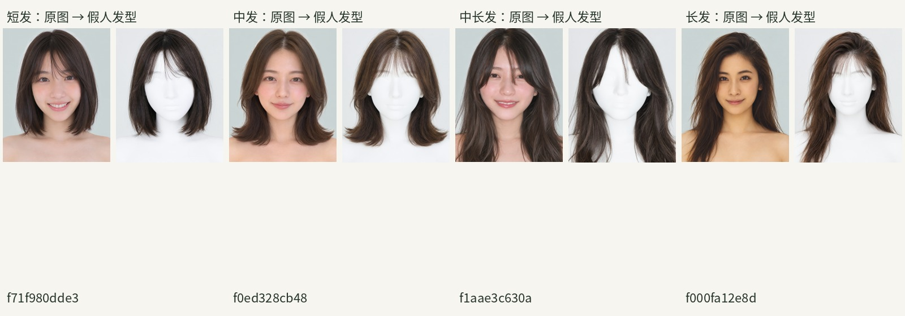
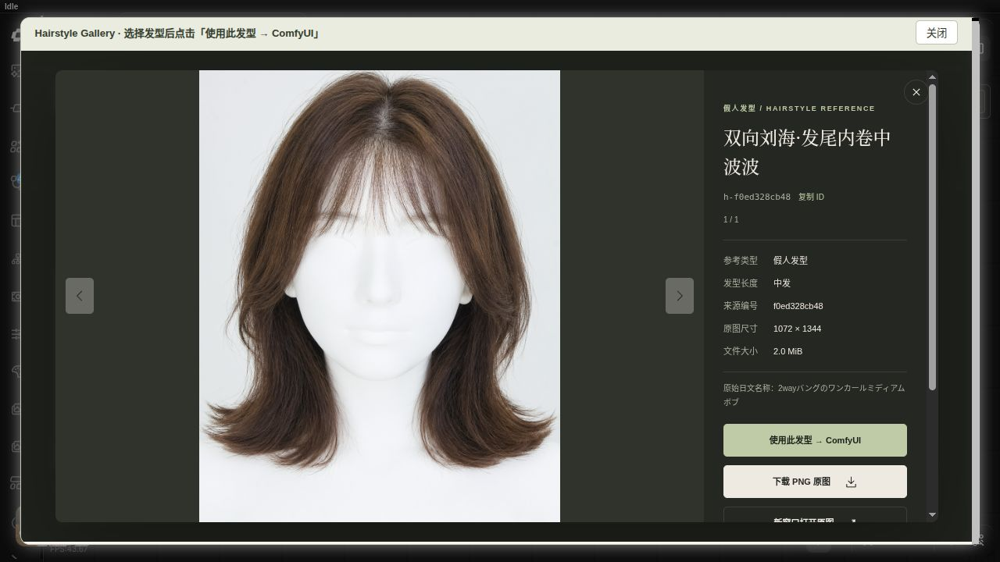
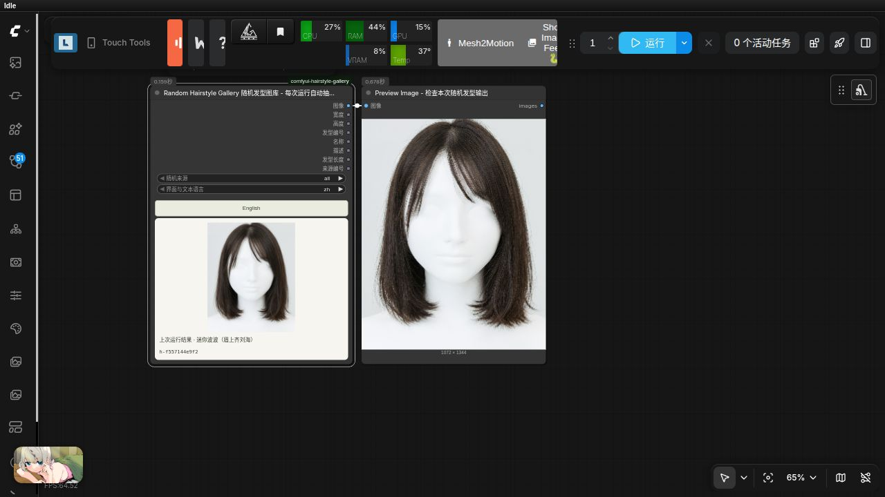
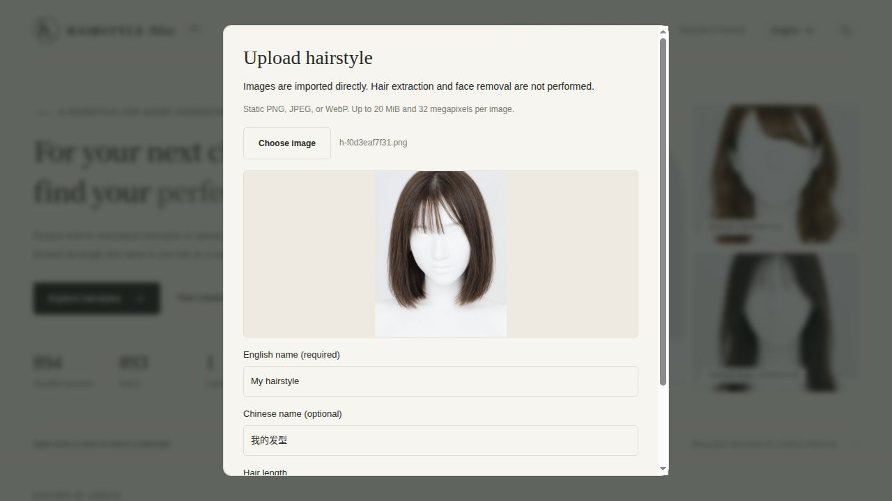
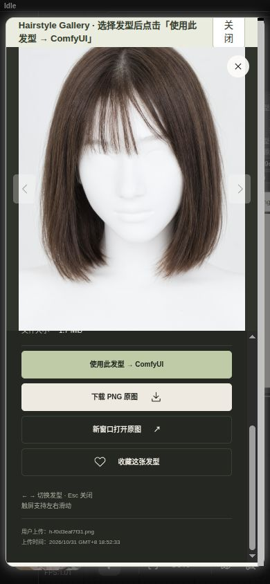
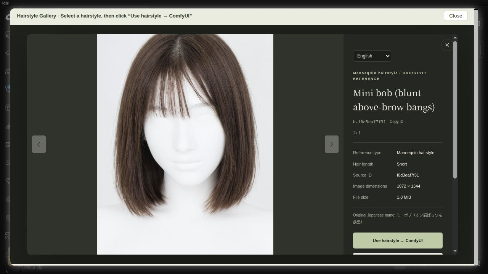

# comfyui-hairstyle-gallery

**简体中文** · [English](README.en.md)

ComfyUI 本地假人发型图库。沿用 Portrait Gallery 的暖色响应式布局、分类筛选、搜索、收藏和大图选择方式，将人物身份与发型参考分开使用。

素材从 `comfyui-portrait-gallery` 的 **893 张正脸参考**生成：短发433张、中发229张、中长发154张、长发77张。造型图不参与本次提取。页面仅展示已生成且已建立索引的结果，生成期间可刷新查看新增素材。



893张均已完成，原图、预览图与缩略图共2,679个资源，约1.87GiB。名称表包含54类名称；其中744张沿用原始细分名称，149张以原始发长类别命名。完整性审计通过，见素材库 `data/audit-report.json`。



## 安装与浏览

在 `ComfyUI/custom_nodes/` 中克隆本仓库，已包含完整893张PNG、预览图、缩略图与名称索引（约1.87GiB，无需另下载ZIP）。安装依赖后重启 ComfyUI 并刷新浏览器。

```bash
git clone https://github.com/wangweihong/comfyui-hairstyle-gallery.git
python -m pip install -r comfyui-hairstyle-gallery/requirements.txt
```

添加 **image → Hairstyle Gallery → Hairstyle Gallery 发型图库**，点击“浏览发型图库”。

按长度或发型风格筛选，也可以搜索中文名称、原始日文名称、发型ID或来源人像ID。打开大图并点击 **使用此发型 → ComfyUI**，选择会写回当前节点并更新预览，不会自动运行。

默认读取节点目录的 `library/`。本机数据实际位于 `/media/wwhvw/备份/comfyui/发型/`，本机安装与容器可访问的图片使用硬链接共享，不复制整套图库。仓库自带可直接使用的 `library/`；也可通过环境变量 `COMFYUI_HAIRSTYLE_GALLERY_LIBRARY` 指向容器内可见的完整素材库路径。

## 每次运行随机：独立节点

添加 **image → Hairstyle Gallery → Random Hairstyle Gallery 随机发型图库**。将 `image` 接入后续工作流或 Preview Image，再点击运行；每次都会自动抽取一张发型，无需点击随机按钮。`origin` 可选 `all`（全部）、`builtin`（内置）、`user`（自定义），`language` 支持中文和英文。随机范围不受浏览页面筛选影响。

新节点提供与原节点相同的八个输出，图像、尺寸、编号、名称、描述、发长和来源编号均对应同一张实际抽中的素材。执行完成后显示本次编号和预览；保存的预览信息不参与下一次抽样。

原 **Hairstyle Gallery** 的输入、固定选图方式、八个输出及旧工作流保持不变。需要固定某次随机结果时，将随机节点输出的 `hairstyle_id` 填入原节点。缺少原图的记录会跳过，无可用原图时提示错误。抽样可能偶然重复；节点本身不会启动或追加任务。

可导入 [`example_workflows/random_hairstyle_preview.json`](example_workflows/random_hairstyle_preview.json)，连续点击运行观察结果；附同名 API 工作流。



## 单张上传自定义发型

1. 在独立图库或节点打开的图库中点击 **上传发型**。
2. 选择一张现成的发型参考图，查看预览，填写当前界面语言的名称；另一语言名称可选。发长默认为 **未分类**。
3. 点击 **保存到图库**。成功后会切换到“自定义”视图、清除当前筛选并打开新图的大图。
4. 点击 **使用此发型 → ComfyUI** 写回当前节点。上传和选择都不会自动运行工作流。

支持静态 PNG、JPEG、WebP，每次一张，最大20 MiB、3200万像素。图片按实际内容校验，完整图转换为PNG并保留原尺寸与透明度，预览和缩略图使用白色背景。上传仅导入图片，**不会自动提取头发或去除人物面部**。首版不包含批量、编辑、删除或自动提取。

自定义素材默认保存在 **`ComfyUI/user/hairstyle_gallery/`**，不写入节点代码或内置库：

```text
user/hairstyle_gallery/
  data/custom.json   自定义名称、来源文件名、发长、尺寸和上传时间
  img/full/          完整PNG
  img/preview/       800×1000内WebP
  img/thumb/         400×500内WebP
```

升级或替换节点代码不会覆盖此目录；备份时请单独备份它。本地ComfyUI服务中的客户端共享此素材库，不按浏览器或账号隔离。可通过 `COMFYUI_HAIRSTYLE_GALLERY_USER_LIBRARY` 指向其他持久化、可写、容器内可见的目录。

图库新增 **全部来源 / 内置 / 自定义** 筛选，并分别统计数量。内置索引缺失时仍能上传和使用自定义素材。自定义编号为 `u-` 加UUID，`source_id` 输出为空；自定义英文名优先使用用户填写的内容，未填写另一语言时显示已有名称，不自动翻译。

接口：`POST /hairstyle_gallery/upload`，multipart字段为 `image`、`name`、可选 `other_name`、`language`（zh/en）、`hair`（unknown/short/medium/medium-long/long）。成功返回201及 `record`、更新后的 `catalog`；失败返回带错误代码的JSON，不写入半成品。原有目录接口仍返回数组，通过 `origin=builtin/user` 区分，图片接口仍只读取登记的编号。





## 中英文切换

- 节点浏览按钮旁的 **English / 中文** 按钮可切换当前节点和内嵌图库；图库右上角也可选择语言。
- 可选输入 `language` 为 `zh`（中文，默认）或 `en`（英文）。语言随工作流保存；旧工作流与API不提供此输入时继续输出中文。
- `name`、`description`、`hair_length` 随语言输出。图像、ID、接口和已有连线不变。
- 发型卡片、风格菜单、大图信息、帮助、搜索与收藏提示均有中英文。54类英文名称译自现有名称，支持英文、中文、日文及来源ID混合搜索。
- 切换语言保留筛选、收藏和当前选图，不会运行工作流。浏览器记住上次偏好；已保存工作流优先使用自身语言。
- 提供 `locales/zh`、`locales/en` 供ComfyUI原生节点定义翻译使用。用户自定义的节点标题保留。



## 输出

| 输出 | 内容 |
| --- | --- |
| image | 完整 RGB 发型参考图，保留原图尺寸；透明部分使用白色背景 |
| width / height | 图像宽高 |
| hairstyle_id | 内置ID为`h-`加来源人像ID；自定义ID为`u-`加UUID |
| name | 根据语言输出中文或英文发型名称 |
| description | 当前语言的参考类型、长度与风格描述 |
| hair_length | 当前语言的短发、中发、中长发、长发或未分类 |
| source_id | 内置素材的原始正脸ID；自定义素材为空字符串 |

`example_workflows/hairstyle_gallery_preview.json` 可直接导入，预览并保存选中的发型图。生成流程为 `example_workflows/flux-klein-hairstyle.json`，附同名API图；复现生成需要安装Portrait Gallery、LayerStyle及原工作流模型。

换发型示例：`example_workflows/qwen21_hairstyle_replace.json`，使用Qwen Image 2.1将所选发型应用到人物底图；需要相应模型，并在Load Image选择本机人物图片。

## 提取配置

基础为用户已有的 `flux-klein-提取发型.json`：FLUX.2 Klein 9B、`Klein-consistency` LoRA 0.8、Qwen3 8B FP8文本编码器、Flux2 VAE、Euler、4步、CFG1、固定种子295046273850143、最短边1080缩放。当前素材输出1072×1344。

原始提示词会留下肤色和五官痕迹，因此批量提示词增加白色假人头模描述。测试中关闭/降低一致性LoRA会改变发长和刘海，正式生成保留0.8权重。白色假人仍可能有浅五官起伏；这是生成式参考图处理，并非透明背景抠发、逐像素分割或严格发型复刻。

本机完整生成记录的 `workflows/`、`jobs/` 和 `experiments/` 保存在原始素材备份目录，不随仓库分发；可复现示例位于 `example_workflows/`。

## 素材文件

```text
发型/
  img/full/       完整 PNG
  img/preview/    800×1000 内 WebP 预览
  img/thumb/      400×500 内 WebP 缩略图
  data/hairstyle-zh.json    中文、日文名称与来源索引
  data/hairstyles.csv      UTF-8 BOM CSV 名称表
  data/source-faces.json   来源正脸元数据
  data/generation-state.json  已完成/失败/进行中状态
  SOURCE.json     来源说明
```

中文名称与日文名称沿用来源记录。英文译名保存在节点的 `translations/names.en.json` 中，API和图库数据会追加 `name_en`、`style_en`、`hair_en`、`section_en` 字段，不覆盖来源数据。没有细分名称时仅以原始发长类别命名，`name_source=source_length_fallback`，不推测不存在的刘海、烫发或发色标签。PNG、预览、缩略图按唯一ID对应，清单记录校验值、来源和种子。

批量脚本支持中断续跑，只处理未完成素材，单次仅提交一项任务，避免堆满ComfyUI队列：

```bash
python3 scripts/batch_extract.py --samples
python3 scripts/batch_extract.py
```

脚本默认匹配本机目录；其他机器可使用 `--library`、`--source`、`--output` 和 `--api` 指定路径与服务地址。

## 检查

```bash
python3 -m unittest discover -s tests -v
node tests/test_core.cjs
node tests/test_i18n.cjs
node --check web/app.mjs
node --check web/hairstyle_gallery.js
node --test tests/test_random_frontend.cjs
```

来源人物素材为 [AI モデル顔データベース](https://ai-portrait-gallery.pages.dev/)，原作者 [あぎ](https://x.com/agi_aibusi)。本项目为独立生成与整理工具，来源和适用范围见 [THIRD_PARTY_NOTICES.md](THIRD_PARTY_NOTICES.md)。独立程序代码适用MIT许可。

发型仍使用现有 `name` 输出，不新增重复端口。固定与随机节点的 `name`、`description` 和 `hair_length` 按 `language=zh/en` 输出；随机预览名称也会即时切换。图库 GitHub 链接已指向本仓库。
